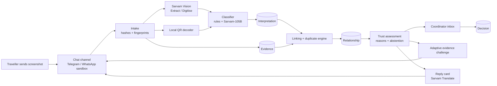

# Pratibimb

**Every screenshot gets an owner, a trail and an honest label for how well it is supported.**

*REWIRED hackathon, Constraint B: MIRROR ("They don't write it down. They screenshot it, and they'll keep screenshotting.")*

> **Status:** design frozen (v3). Member C's synthetic fixtures, local coordinator dashboard, evaluation harness, interview/timing templates and HTML pitch deck are present. Member A/B runtime services, a real coordinator interview, consented real screenshots and measured performance results are not present yet. Everything marked **(proposed)** remains an engineering target, not a measured result. Facts about the metro bot must be re-checked by our own Day-0 test.

> **Member C build:** start with [synthetic data](data/README.md), [dashboard instructions](dashboard/README.md), [evaluation kit](eval/README.md), the [pitch deck](pitch/index.html) and the [handoff status](docs/member3_handoff.md). Fixture scores must not be presented as real-world performance.

---

## Table of contents

1. [The problem](#1-the-problem)
2. [The idea in one paragraph](#2-the-idea-in-one-paragraph)
3. [Who it is for](#3-who-it-is-for)
4. [How the process runs today and where it breaks](#4-how-the-process-runs-today-and-where-it-breaks)
5. [How we satisfy Constraint B (MIRROR)](#5-how-we-satisfy-constraint-b-mirror)
6. [Core principle: what Pratibimb does and does not claim](#6-core-principle-what-pratibimb-does-and-does-not-claim)
7. [System design](#7-system-design)
8. [The four record types](#8-the-four-record-types)
9. [Evidence levels and relationship types](#9-evidence-levels-and-relationship-types)
10. [Screenshot types](#10-screenshot-types)
11. [Duplicate detection](#11-duplicate-detection)
12. [Adaptive evidence challenge](#12-adaptive-evidence-challenge)
13. [Where Sarvam AI is used](#13-where-sarvam-ai-is-used)
14. [Privacy and retention](#14-privacy-and-retention)
15. [Day-0 feasibility gate](#15-day-0-feasibility-gate)
16. [API surface](#16-api-surface)
17. [Tech stack (suggested)](#17-tech-stack-suggested)
18. [Repository layout (proposed)](#18-repository-layout-proposed)
19. [Evaluation plan](#19-evaluation-plan)
20. [Demo flow](#20-demo-flow)
21. [Limits and threat model](#21-limits-and-threat-model)
22. [Team and work split](#22-team-and-work-split)
23. [Seven-day plan](#23-seven-day-plan)
24. [Roadmap beyond the hackathon](#24-roadmap-beyond-the-hackathon)
25. [Open questions](#25-open-questions)
26. [References](#26-references)

---

## 1. The problem

India runs on WhatsApp. Processes it was never designed for, such as exam notices, clinic confirmations, shop orders and society dues, run on forwards, voice notes and screenshots. It works until it does not.

The challenge: **pick one real process, prove where it breaks, and redesign it so it no longer depends on that jugaad.** Our constraint is **B (MIRROR)**: the way into the system must be a screenshot, and the screenshot must lead to something the process can act on.

## 2. The idea in one paragraph

Namma Metro (Bengaluru) already sells QR tickets through a WhatsApp chatbot. The bot *issues* the ticket, and then nobody owns it. When a group travels (company staff on a project, fest volunteers, a school trip), one **coordinator** pays for and answers for the whole journey, yet every answer ("who has a ticket?", "whose payment failed?", "who gets reimbursed?") is a screenshot in a chat. Pratibimb keeps the screenshot habit and puts a system of record behind it. Travellers send whatever screenshot they have to one number. Pratibimb reads it, files it as immutable evidence, links it to related evidence, labels how well each claim is supported, and shows the coordinator **only what does not balance**.

> *"The metro bot issues the ticket. Pratibimb owns everything after it: who has it, what went wrong, and who gets paid, in the language the traveller uses."*

## 3. Who it is for

| Person | Role | What they do | What they get |
|---|---|---|---|
| **Traveller** | Employee, volunteer, student | Sends any screenshot to one number | A reply card (image) in their language: ticket received, payment found but no ticket (case opened), more evidence needed, or could not read |
| **Coordinator** | HR/admin, organiser, teacher, trek leader | Reviews exceptions; approves, requests proof, rejects, or links manually | Roster, exceptions inbox, evidence trail, claim sheet |
| **Finance / operator (optional)** | Reimbursement approver, transit staff | Reads the export or complaint packet | Claim sheet with link types and evidence levels; failure patterns |

## 4. How the process runs today and where it breaks

One process, one owner, seen at three moments:

| Stage | Coordinator's question | What breaks today |
|---|---|---|
| **Before travel** | Who is ready? | Tickets are lost in group scroll or sent to the wrong person; heads are counted by hand |
| **During a failure** | Who is stuck? | "Money deducted, no ticket" screenshots are scattered, untracked and asked for repeatedly |
| **After travel** | Who gets paid? | Dates, fares and duplicates are checked by eye against a spreadsheet; the same ticket can be claimed twice |

Duplicate and reuse checks are not a fourth problem. They are the shared engine under all three stages.

**What public sources show (to be re-checked in Day-0):**
- The Namma Metro WhatsApp chatbot launched on 31 October 2022 in English and Kannada, with UPI payment; QR tickets are valid until the end of metro service that day, and cancellation and refund are supported.
- Public complaint posts describe payments debited without a QR ticket being issued, with the bot saying failed bookings are refunded to source within 7 working days, and some users reporting refunds still missing after more than two weeks.
- The WhatsApp ticketing channel was reported down on 26 September 2025, with the app, Paytm, ONDC apps and counters as alternatives, so real screenshots come from mixed sources and formats.
- BMRCL's grievance guidance warns about scam messages claiming a QR ticket refund has failed.

Complaint-site posts are **anecdotes, not a measured failure rate**. Our own interviews and Day-0 test provide the proof.

## 5. How we satisfy Constraint B (MIRROR)

| Requirement | How |
|---|---|
| The way in must be a screenshot | Travellers send whatever screenshot they already have; they never say what it is. The system classifies it |
| The screenshot must lead to something the process can act on | It becomes a roster entry, an open case, a link to related evidence, or a claim-sheet line with flags |
| Users keep screenshotting | No app install, no typing, no forms; reply cards are images, because users screenshot those too |
| No longer depends on the jugaad | WhatsApp or Telegram is only the door. The ledger, links, decisions and dashboard are the system of record |

## 6. Core principle: what Pratibimb does and does not claim

> **Pratibimb does not establish truth. It establishes ownership, evidence relationships, consistency and accountability.**

- A screenshot is a **claim**, not proof.
- Two fabricated screenshots can agree with each other, so agreement means *consistent*, not *true*.
- The product never says "fraud" and never says "verified" unless an authoritative source confirmed that specific attribute. It says *extracted*, *corroborated*, *unverified*, *needs review*.
- "Travelled" is the traveller's own assertion; "approved" is a coordinator's decision. Neither is a machine conclusion.

## 7. System design



**Boundary:** Sarvam reads and explains. Pratibimb's own deterministic code links, scores and records. Nothing a model returns becomes a Relationship or Decision without passing through that code.

## 8. The four record types

Four things are kept **separate and immutable**. They are never merged into one mutable transaction row.

| Record | What it holds |
|---|---|
| **Evidence** | What the user submitted: file reference, exact hash, perceptual fingerprints, sender, channel, time |
| **Interpretation** | What the system extracted: screenshot type, fields, per-field confidence, producer and model version, Sarvam job ID |
| **Relationship** | Why two items were linked: type, matched attributes, score, creator |
| **Decision** | What an authorised human decided: who, action, reason, and a hash of what they saw |

```text
Evidence       { evidence_id, trip_id?, sender_id, channel, received_at,
                 file_ref, sha256, phash, ahash?, status }
Interpretation { interp_id, evidence_id, producer, model_version, sarvam_job_id?,
                 screenshot_type, type_confidence, fields{}, field_confidence{},
                 raw_text_ref, language_detected, created_at, supersedes? }
Relationship   { rel_id, from_id, to_id, type: EXACT|INFERRED|MANUAL|UNMATCHED,
                 basis[], score, created_by, created_at, supersedes? }
Decision       { dec_id, subject_ref, action, decided_by, reason,
                 seen_snapshot_hash, created_at, supersedes? }
```

- **Append-only.** Corrections are new records with a `supersedes` pointer. Nothing is silently overwritten.
- **Hash-chained.** Each record's `record_hash = H(record + prev_hash)`. An audit endpoint detects any edited row. This gives tamper *evidence*, not tamper *prevention*, and it is not a blockchain.
- **Re-extraction** with a newer model is a new Interpretation, so history is preserved.

Fields extracted per screenshot (nulls are valid; an invented value is a bug):

```text
amount, currency, timestamp, utr, order_id, ticket_id, qr_payload,
origin_station, destination_station, fare, payer_name_masked, payee_name,
status_text, app_name, bank_name, language_detected
```

## 9. Evidence levels and relationship types

**Evidence levels** (always scoped to a specific claim attribute):

| Level | Meaning |
|---|---|
| **Extracted** | Fields were successfully extracted from submitted evidence |
| **Corroborated** | Independent evidence sources agree on relevant transaction attributes |
| **Independently verified** | An authoritative source confirms that specific transaction or ticket |

A bank statement can independently verify a *debit*, but not necessarily that a *ticket was issued*. Verification is stored per attribute, for example `debit: verified`, `ticket_issued: not verified`. Without an external source, the system can reliably reach only the first two levels.

**Relationship types** (shown in the inbox and in the exported sheet):

| Type | Basis | Auto-clear? |
|---|---|---|
| **EXACT** | Shared transaction or ticket identifier | Eligible, if no other flag |
| **INFERRED** | Amount, timestamp, payer and journey context agree | Never; always reviewed |
| **MANUAL** | Coordinator explicitly linked the evidence | n/a (a Decision) |
| **UNMATCHED** | Insufficient evidence | Preserved and shown; never forced into a link |

Ambiguity (two plausible matches) yields UNMATCHED with both candidates listed, not a guess.

**Machine-observed states:** `payment_seen`, `ticket_seen`, `linked (EXACT|INFERRED)`, `case_opened`, `refund_evidence_seen`.
**Human assertions, stored separately:** `traveller_asserts_travel`, `coordinator_decision: approved | rejected | proof_requested`.

## 10. Screenshot types

| Code | Meaning |
|---|---|
| `TICKET_QR` | Metro QR ticket screen |
| `UPI_SUCCESS` | UPI payment success screen |
| `UPI_FAILED_PENDING` | Payment failed, pending or processing |
| `BANK_SMS` | Bank debit or credit alert |
| `REFUND_NOTICE` | Refund message or bank refund credit |
| `BOT_ERROR` | Metro bot message saying booking failed |
| `CLAIM_SUBMISSION` | Ticket submitted as a reimbursement claim |
| `SUSPECT_NOTICE` | Refund- or KYC-scam-style message, not an official notice |
| `OTHER` | Anything else (low confidence never forces a guess) |

## 11. Duplicate detection

Three separate layers, none replacing the others:

| Layer | Key | Strength | Limit |
|---|---|---|---|
| **Semantic** | Normalised ticket ID, UTR, order ID, QR payload | Strongest signal | Only if the field is readable |
| **Exact file** | SHA-256 | Exact resend, integrity | Breaks on any crop or recompression |
| **Perceptual** | pHash / aHash within a Hamming threshold | Cropped or recompressed reuse | Similarity signal only, can false-positive |

Same ID from the same sender (a resend) is treated differently from the same ID from a different sender. Perceptual matches are signals, not conclusions; a human decides.

## 12. Adaptive evidence challenge

When a claim is `needs_review` with a specific unresolved attribute, the bot asks for the smallest extra item that would conflict with a weak claim.

| Question | Answer |
|---|---|
| What does it ask for? | Bank SMS, payment-app history list, or the ticket with status bar and time visible |
| Why? | The message names the unresolved check ("UTR unreadable", "no second source for this payment") |
| If the user cannot provide it | The claim stays "corroborated, unverified" and goes to the coordinator with the reason. **Never auto-rejected** |
| Threat model | Defeats accidental omission, single pre-made fakes and simple reuse. **Does not** stop someone who generates a full consistent set |

## 13. Where Sarvam AI is used

Hackathon requirement: the **Sarvam AI API**. It fits naturally because the Namma Metro bot runs in English and Kannada, so ticket and error screenshots may contain Kannada text.

| Stage | Sarvam component | Notes |
|---|---|---|
| Read the screenshot | **Sarvam Vision 1.5, Document AI `extract`** | Schema-based field extraction, one JSON schema per screenshot type; 22 Indian languages plus English |
| Raw text and fallback | **Document AI `digitise`** | Full OCR; stores raw text for inspection |
| Classify and structure | **Sarvam-105B** | Classifies ambiguous screenshots and returns a one-line reason |
| Language of replies | **Sarvam Translate** (23 languages) or **Mayura** (10 Indian languages plus English) | Pre-translate fixed card strings; translate dynamic reasons on demand |
| Optional voice reply | **Bulbul TTS** | Bonus only; not part of Constraint B |

**Not done by Sarvam:** QR decoding, fingerprinting, linking, scoring, the ledger. Nothing in the docs we read says Vision decodes QR codes, so a local decoder is used.

**Known risks:**
- Document AI is built around documents (PDFs, forms, invoices); phone screenshots are an unvalidated fit until Day-0.
- It is **asynchronous** (create job, poll status, download result), so replies use a "processing" card and live-demo latency must be measured.
- Screenshots reach a third-party API before masking. Sarvam's retention and residency terms must be read before we claim anything about privacy.
- **Fallback:** if Vision is weak on screenshots, use Digitise for raw text plus Sarvam-105B for structuring, or a general vision model for extraction, keeping Sarvam for translation and reasons.

Model IDs, limits and endpoints: verify at docs.sarvam.ai before coding.

## 14. Privacy and retention

- The coordinator API returns **fields, not images** ("Meera · ₹40 · Indiranagar to MG Road · EXACT"). Raw-image access needs an explicit request that is logged (who, when, why).
- Fields are masked at the API layer (partial names and UTRs, hidden phone numbers) unless a Decision requires the full value.
- After processing, the raw image is encrypted and access-controlled until the case closes or a fixed period passes, then deleted. **The exact period is a product decision to confirm with a privacy or legal reviewer.** Deletion is logged and tested.
- Retained: extracted fields, fingerprints, confidences, decisions.
- Honest wording: **"masked fields plus fingerprints."** We do not claim zero-knowledge.

## 15. Day-0 feasibility gate

The biggest untested assumption: can we obtain, read and link the screenshots of a real metro journey? Before building, we test it.

1. Buy 5 real tickets across at least two channels (WhatsApp bot, Namma Metro app, ideally one more); cancel one.
2. Screenshot everything: ticket, UPI success, bank SMS, cancellation, refund SMS, bot errors.
3. Run each through Sarvam Vision Extract and Digitise; record fields, misses, wrong values and latency.
4. Test exact, cropped, recompressed and screenshot-of-screenshot duplicates.

*Proposed engineering criteria, not measured results. Set numeric thresholds before looking at results.*

| Test | Required outcome |
|---|---|
| Ticket extraction | Readable fields and QR payload identified |
| Payment extraction | Amount, timestamp, UTR extracted where present |
| Sarvam suitability | Usable fields on real screenshots (English and Kannada), latency recorded |
| Cross-source linking | Whether a shared identifier exists |
| Duplicate detection | Exact and cropped versions both tested |
| Refund correlation | Whether a refund references the original transaction |
| Failure handling | Unmatched evidence preserved without inventing relationships |

| Decision | Condition |
|---|---|
| **Proceed with exact linking** | Reliable shared identifiers exist |
| **Proceed with inferred linking** | Only contextual matching works; mandatory review |
| **Reconsider scope** | Essential fields cannot be extracted, or participants cannot be reliably identified |
| **Sarvam fallback** | Vision fails on screenshots: Digitise plus Sarvam-105B, or another extractor, with Sarvam kept for translation and reasons |

## 16. API surface

| Endpoint | Purpose |
|---|---|
| `store.add_evidence`, `store.add_interpretation` | Ingest (from the intake service) |
| `POST /trips`, `POST /trips/{id}/join-code` | Coordinator creates a trip and shares a join code |
| `GET /trips/{id}/summary` | Roster and counts |
| `GET /trips/{id}/inbox` | Exceptions only, with reasons |
| `GET /records/{id}/trail` | Evidence, Interpretation, Relationships and Decisions for one item |
| `POST /decisions` | Approve, request proof, reject, link manually |
| `POST /challenge/{id}` | Trigger an adaptive evidence challenge message |
| `GET /audit/verify` | Hash-chain integrity check |
| `GET /export/claims?trip_id=` | Claim sheet with relationship types and evidence levels |

## 17. Tech stack (suggested)

| Layer | Suggestion |
|---|---|
| Backend | Python, FastAPI |
| Store | SQLite (demo) or Postgres, append-only tables |
| Chat channel | Telegram bot (primary demo); Twilio WhatsApp sandbox (secondary). Production would use the WhatsApp Business API; bots generally cannot read ordinary groups, so users send or forward to the bot 1:1. Check current rules |
| Extraction | Sarvam Document AI (Vision 1.5), Sarvam-105B, Sarvam Translate |
| QR and images | OpenCV or pyzbar; imagehash (pHash/aHash); Pillow for reply cards |
| Dashboard | React or Streamlit against the API |
| Export | CSV and XLSX |

## 18. Repository layout (proposed)

```text
pratibimb/
├── README.md
├── docs/
│   ├── day0_feasibility_report.md
│   ├── privacy_and_retention.md
│   └── threat_model.md
├── intake/                # Member A: channel, hashing, QR, fingerprints
├── extraction/            # Member A: Sarvam clients, schemas, classifier
│   └── schemas/           # one JSON schema per screenshot type
├── cards/                 # Member A: reply-card generator, translations
├── core/                  # Member B: store, chain, linking, duplicates, trust
├── api/                   # Member B: FastAPI endpoints
├── dashboard/             # Member C: coordinator UI
├── eval/                  # Member C: dataset, scorer, harness
│   ├── data/              # masked screenshots + ground truth (not committed if sensitive)
│   └── results/
├── fixtures/              # shared fixture Interpretations
└── tests/
```

## 19. Evaluation plan

Report **only what is measured**, on a held-out split that is never used for tuning.

| # | Metric | Notes |
|---|---|---|
| 1 | **Extraction and linking accuracy** | Per screenshot type, app and language; linking accuracy by relationship type |
| 2 | **False-accept rate, reported with coverage** | At the chosen threshold: wrongly cleared bad items and share auto-cleared |
| 3 | **Coordinator time** | With Pratibimb vs a manual baseline on the same set |

Also: an honest **"where it fails"** table, a drift check (the false-accept result only holds if new cases resemble the calibration data), and an optional comparison of a pixel-level edit detector against evidence-based handling on fakes from at least two image generators.

**Dataset:** 20 to 30 consented, masked real screenshots per context plus labelled synthetic ones (exact, cropped and recompressed duplicates, out-of-window dates, payment without ticket, wrong payee, partial amount, AI-generated fakes labelled by source). Split into calibration and held-out test.

**Problem proof:** at least one real coordinator interviewed (three if possible), traveller questions on failed payments, and a timed human baseline.

## 20. Demo flow

About three minutes:

1. **The mess:** a chat of mixed screenshots with a duplicate, a payment with no ticket and an out-of-window ride.
2. **Drop it in:** the roster fills as screenshots are processed.
3. **Inbox:** only the exceptions ("3 of 40 need review"), each with a reason and a relationship type.
4. **Trail:** one item opened into Evidence, Interpretation, Relationship and Decision panels.
5. **Judge's turn:** a judge sends any screenshot live; it is classified and linked.
6. **Break me:** a fake triggers the adaptive evidence challenge; the verdict states how well it is supported, with a visible scoreboard that includes what got through.
7. **Tamper test:** edit a past row; the audit check breaks at the right link.

A backup video is recorded in case of network or API latency.

## 21. Limits and threat model

- A screenshot is a claim, not proof.
- "Travelled" is the traveller's assertion; we cannot see gate scans.
- We cannot issue refunds or confirm the operator's records. We structure evidence, track cases and record decisions.
- Corroboration shows consistency, not truth; two fabricated items can agree.
- The adaptive evidence challenge raises the cost of a fake but does not end it.
- If the QR payload is opaque or signed, it is used as a duplicate key only, never as a validity claim.
- Results hold only on data resembling what we calibrated on.
- We detect and flag reuse. We never help anyone bypass a gate.
- Facts about the metro bot come from public sources and our own small Day-0 sample.

## 22. Team and work split

Assumes three members (adjust if different).

| Member | Role | Owns |
|---|---|---|
| **A** | Intake and extraction | Chat channel, Sarvam integration, QR decoding, classifier, fingerprints, reply cards, Day-0 test, raw-image lifecycle |
| **B** | Core engine and trust | Append-only store, hash chain, duplicate engine, linking, states and cases, trust assessment, challenge, privacy, calibration, API |
| **C** | Product, evaluation, pitch | Interviews, dataset, dashboard, claim sheet, evaluation harness, break-me station, demo, deck |

Detailed task lists are in the three work-distribution files.

## 23. Seven-day plan

| Day | A | B | C |
|---|---|---|---|
| **1** | Day-0 gate; channel start | Schema, stubs, hand-made fixtures | Book interviews; join Day-0; labelling guide |
| **2** | Channel working; Extract on 20 screenshots; QR; **10 real fixtures** | Hash chain; endpoints on fixtures; semantic and exact duplicates | Interviews; roster and inbox on fixtures |
| **3** | All schemas; classifier; fingerprints | Perceptual layer; EXACT and INFERRED linking; masking | First labelled batch; trail view; baseline timing |
| **4** | Reply cards (English, Kannada, Hindi) | States, cases, reasons, abstention | Decision buttons; claim export; synthetic and fake generation |
| **5** | Lifecycle worker; challenge flow; integration | Challenge flow; decisions; export | Audit view; live integration; dry run |
| **6** | Scoring runs; fakes for break-me | Calibration; drift check; tamper script | Evaluation; break-me station; backup video; deck |
| **7** | Freeze; rehearse channel and latency fallback | Freeze schema; regression tests | Rehearse demo and Q&A |

## 24. Roadmap beyond the hackathon

- The same engine on **housing-society collections** (money in): shown as one slide, not built.
- Independent verification sources (operator records, bank statement imports) to reach the third evidence level where available.
- WhatsApp Business API production channel.
- More languages for reply cards and extraction.
- Failure-pattern analytics for operators (for example, time and station clusters), clearly labelled as aggregate insight.

## 25. Open questions

1. What do real tickets and payment screens contain, and is there a shared identifier? *(Day-0)*
2. How well does Sarvam Vision read phone screenshots in English and Kannada, and at what latency? *(Day-0)*
3. What are Sarvam's data-retention and residency terms?
4. What is the right retention period for raw images? *(needs privacy or legal review)*
5. Which real coordinator(s) can we interview?
6. Are channel limits (WhatsApp sandbox, API approval) acceptable for the demo?

## 26. References

- BMRCL and WhatsApp QR ticketing launch, 31 October 2022 (TechCrunch, PTI/The Week, The Logical Indian).
- BMRCL end-to-end WhatsApp ticketing coverage (South First).
- Namma Metro WhatsApp ticketing outage, 26 September 2025 (OneIndia).
- Public complaint posts on debited-no-ticket cases (consumercomplaints.in, indiacustomercare.com) used as anecdotes only.
- BMRCL grievance guidance and refund-scam warning (complainthub.org summary).
- Sarvam AI documentation: Document Intelligence overview, models overview (docs.sarvam.ai).

---

*Pratibimb: Hindi for "reflection". The screenshot is the reflection; we keep the record behind it.*
